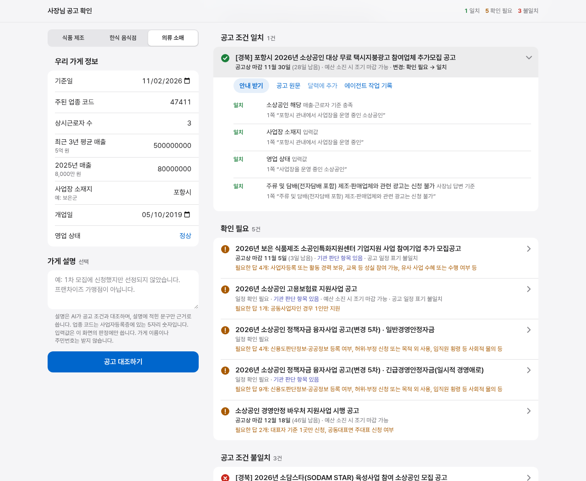

# 사장님 비서

소상공인 지원공고, 임대차 계약서, 법령을 확인하는 시제품입니다. 2026년 하반기 AI 경진대회 학생 부문 출품작입니다.

법률 해석과 자격 확정은 하지 않습니다. 최종 자격은 주관기관에, 법률 문제는 전문가에게 확인하세요. 가상 데이터로만 시험했고 실제 사용자 테스트는 하지 않았습니다.

**배포 완료:** https://sosang-agent.vercel.app (사람당 AI 테스트 5회, 규칙 대조는 제한 없음)

[시연 영상 보기(89초, 무음)](docs/demo/demo_20261103.mp4): 가상 데이터로 실제 화면을 조작한 녹화입니다.

## 사용 방식

- **공고 대조하기:** 조건표와 온톨로지로 바로 계산합니다. 판단에 AI를 쓰지 않습니다.
- **AI 공고 대조:** AI가 공고 전체를 읽어 더 정확합니다. 먼저 질문에 답한 뒤 누르면 결과가 더 정확해집니다.

## 구조

- **멀티에이전트:** 역할별 에이전트 12개. 공고 준비는 총괄 에이전트가 도구 호출로 추출·검사·검증·재추출을 조율하고, 대조는 코드 파이프라인이 규칙, 진술 대조, 조건 판단, 최종 판단 순서로 호출합니다.
- **온톨로지:** 업종 계층, 소기업 매출 기준, 제외 업종, 임대차 규칙을 RDF로 관리하고 SHACL로 검증합니다.
- **근거 검증:** 응답을 JSON 스키마로 고정하고, 근거 문구가 공고 원문에 있는지 코드로 대조합니다.
- **평가:** 역할을 하나씩 뺀 비교 실험, 코드·정답 해시 고정 측정, 호출별 비용 기록.

## 기능

| 기능 | 내용 |
|---|---|
| 공고 대조 | 조건 일치/불일치/확인 필요, 조건별 원문 근거, 필요한 항목만 질문 |
| 돈 항목 | 지원 방식, 갚는 돈인지, 금액 |
| AI 공고 대조 | LLM이 기간 내 공고 전체를 읽고 규칙 결과와 함께 최종 판단. 입력 부족과 공고 부족을 구분해 안내 |
| 임대차 | 계약서의 날짜·금액 추출, 조문 기간 대입. 권리 유무는 판단하지 않음 |
| 법령 | 바뀐 규칙과 조문 안내. 개별 사건 판단은 상담처 안내 |
| 행정 달력 | 일정 통합, 7일 내 일정 표시, 알림이 들어 있는 달력 파일 |

규칙과 온톨로지 정리: [docs/rules_20261102.md](docs/rules_20261102.md)

## 측정 결과

공고 10건, 가상 사례 30건으로 측정한 최종 버전 결과입니다. 기존 24사례 21건, 코드와 정답을 고정하고 추가한 공고 6건의 사례 6개는 모두 정답과 같았습니다.

| 항목 | 결과 | 뜻 |
|---|---|---|
| 공고 상태 정답 일치 | 27/30, 사장님 답변 반영 시 28/30 | 가게와 공고 조건을 대조한 결론(일치·불일치·확인 필요)이 정답과 같은 사례 수 |
| 잘못된 일치 | 0건 | 정답이 불일치·확인 필요인데 일치라고 답한 사례 수. 사장님이 헛걸음하는 가장 위험한 오류 |
| 공고 접수기간 상태 | 24/24 | 기준일이 공고의 신청기간 안인지, 이미 마감됐는지를 맞힌 사례 수 |
| 근거 문구 인용 오류 | 0건 | 근거로 제시한 공고 문구가 원문에 없는 경우의 수. 문구의 존재를 코드로 확인하며, 해석까지 검증하지는 않음 |

### 정답과 다른 3건

모두 틀린 일치 없이 확인 필요로 답한 사례입니다. 가평군은 사장님 답변으로 결론이 나고, 남은 2건은 공고 설명이 부족합니다.

| 사례 | 정답 → 시스템 | 이유 |
|---|---|---|
| 카페를 겸업하는 빵 공장 | 불일치 → 확인 필요 | 본문은 기술 기준, 각주는 영위기업 기준이라 겸업 기업에 무엇을 적용하는지 공고에 없음. 보호 기술의 용도도 입력에 없음 |
| 직원 없는 1인 기업 | 불일치 → 확인 필요 | 본문 제외 항목에 없고 별첨 표에만 있어, 제외 사유인지와 무엇이 우선인지 공고에 없음 |
| 가평군 예비 창업자 | 불일치 → 확인 필요 | 본문은 비수도권인데 별첨 우대표에 가평군이 있고, 예비 창업자의 이전 예외 포함 여부도 공고에 없음. 이전 계획도 입력에 없음 |

- 같은 사례의 첫 측정에서 LLM 직접 응답은 20/24, 잘못된 일치 0건입니다.
- 정답은 AI가 작성했고 전문가 검증은 받지 않았습니다. 표본이 작아 공고 전반의 정확도는 아닙니다.

비교군별 결과와 측정 이력, 한계: [results/RESULTS_20261102.md](results/RESULTS_20261102.md), 사전 고정 기록: [docs/holdout4_preregistration_20261102.md](docs/holdout4_preregistration_20261102.md)

## 사용 도구

- Claude API(`claude-opus-5-5`): 시스템 내 에이전트
- Claude Code: 코드 작성, 데이터 수집, 평가 실행 보조
- Codex CLI: 기획 검토, 정답 라벨과 보고서 감수
- rdflib, pySHACL, FastAPI, PyMuPDF, matplotlib
- 데이터: 중소벤처기업부 사업공고, 기업마당 공개 공고, 국가법령정보센터 조문(2026-11-02 수집)

## 팀원

- [@Kim-Da-yeon](https://github.com/Kim-Da-yeon)
- [@hjiyun](https://github.com/hjiyun)
- [@seram1212](https://github.com/seram1212)
