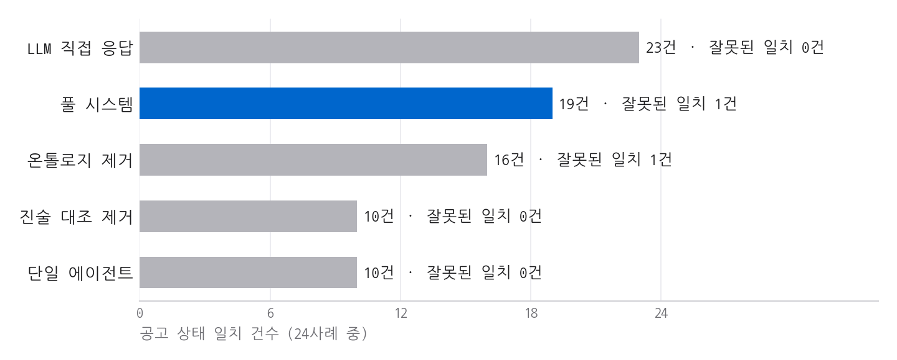

# 측정 결과 정리 (2026-11-02)

## 측정 이력

| 회차 | 공고·사례 | 성격 | 풀 시스템 | 직접 응답 | 잘못된 일치(풀/직접) |
|---|---|---|---|---|---|
| v1 평가 | 7건·42 | 코드 고정 후 첫 측정 | 26 | 38 | 0 / 2 |
| v1 재측정 | 7건·42 | **사후**(오답 보고 수정) | 36 | 38 | 0 / 2 |
| 1차 새 공고 | 5건·30 | 사전 고정 측정 | 15 | 24 | 0 / 0 |
| 1차 재측정 | 5건·30 | **사후**(오답 보고 수정) | 20 | 24 | 1 / 0 |
| **2차 새 공고** | 4건·24 | **사전 고정, 주 수치** | **19** | **23** | **1 / 0** |

## 2차 새 공고 비교군

| 비교군 | 공고 상태 일치 | 잘못된 일치 | 확인 필요 재현율 | 기간 일치 |
|---|---|---|---|---|
| 풀 시스템 | 19/24 | 1 | 4/5 | 24/24 |
| 진술 대조 제거 | 10/24 | 0 | 5/5 | 24/24 |
| 단일 에이전트 | 10/24 | 0 | 5/5 | 24/24 |
| 온톨로지 제거 | 16/24 | 1 | 4/5 | 24/24 |
| LLM 직접 응답 | 23/24 | 0 | 5/5 | 24/24 |

공고별 풀 시스템 일치: 비즈플러스 3/6, 소공인 인프라 6/6, 초기창업 5/6, 포항 5/6.

## 해석

- 정확도: 직접 응답 우세. 전 회차 동일
- 효과 확인: 진술 대조 +9건, 온톨로지 +3건(2차 기준)
- 효과 없음: 재검증 루프(단일 에이전트와 공고 상태 일치 동일, 2차 10건 대 10건)
- 추출 F1(relaxed): 풀 0.878, 단일 0.869. 인용 오류 0건
- 재현성: 진술 대조 3회 반복 시 상태 변경 0건(1차 30사례, 2차 24사례). 직접 응답 3회 반복 시 30사례 중 3건 변경(BN5, CO1, JE5)
- 기관 판단 표시: 2차 18/18
- 금지 표현: 최종 안내 카드 42건 0건(v1 평가), 1차 새 공고 30건 0건

## 비용(토큰×단가 추정, 실제 청구는 Console 기준)

| 항목 | 값 |
|---|---|
| 직접 응답 1회 | 약 $0.067 |
| 진술 대조 1회 | 약 $0.009 |
| 공고 1건 조건 확정 | 약 $0.5(2차 기준 추정) |
| 규칙 판정 | LLM 호출 없음 |

## 한계

- 라벨: AI 초안 + 코덱스 감수 + 참가자가 애매한 조항 확인. 기관 판단 조항 처리 1건은 미확정
- 참가자 정답 수정(BE4, BN5, JE1, JE2, TX5)은 전체 점수를 본 뒤 반영. 시스템 재실행과 코드 수정 없이 저장 응답을 재채점(`scripts/apply_participant_labels_20261102_v1.py`). 수정 전 2차 수치: 풀 20/24, 직접 응답 24/24
- 프로필: 전부 가상. 실제 사장님 테스트 없음
- 프로필의 자유 문장은 AI가 작성. LLM 계열 비교군에 유리할 가능성
- 표본 작음. 공고 전반 정확도 아님
- 2차 공고 선정: 제목 기준. 평창은 원문이 서식뿐이라 측정 전 제외. 소공인 인프라는 신청 주체가 지자체
- 코덱스 지적 중 불채택 항목: `docs/holdout_preregistration_20261102.md`
- 시간 절감, 매출 효과: 미측정
