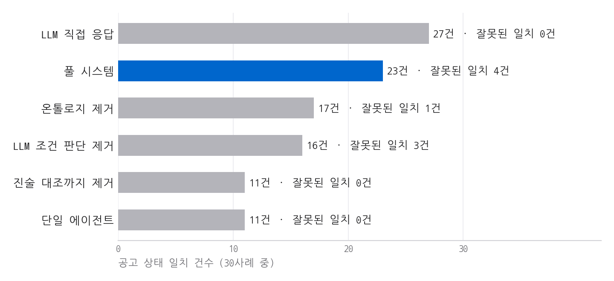

# 측정 결과 정리 (2026-11-02)

## 측정 이력 (참가자 확인 정답 기준)

| 회차 | 공고·사례 | 성격 | 풀 시스템 | 직접 응답 | 잘못된 일치(풀/직접) |
|---|---|---|---|---|---|
| v1 평가 | 7건·42 | 첫 측정 | 26 | 38 | 0 / 2 |
| v1 재측정 | 7건·42 | **사후** | 36 | 38 | 0 / 2 |
| 1차 새 공고 | 5건·30 | 사전 고정 | 15 | 24 | 0 / 0 |
| 1차 재측정 | 5건·30 | **사후**(진술 대조) | 20 | 24 | 1 / 0 |
| 1차 재측정 | 5건·30 | **사후**(LLM 판단 추가) | 23 | 24 | 3 / 0 |
| 2차 새 공고 | 4건·24 | 사전 고정 | 19 | 23 | 1 / 0 |
| 2차 재측정 | 4건·24 | **사후**(LLM 판단 추가) | 19 | 23 | 1 / 0 |
| **3차 새 공고** | **5건·30** | **사전 고정, 주 수치** | **23** | **27** | **4 / 0** |

## 3차 새 공고 비교군

| 비교군 | 공고 상태 일치 | 잘못된 일치 | 확인 필요 재현율 | 기간 일치 |
|---|---|---|---|---|
| 풀 시스템 | 23/30 | 4 | 7/10 | 30/30 |
| 온톨로지 제거 | 17/30 | 1 | 9/10 | 30/30 |
| LLM 조건 판단 제거 | 16/30 | 3 | 6/10 | 30/30 |
| 진술 대조까지 제거 | 11/30 | 0 | 5/10 | 30/30 |
| 단일 에이전트 | 11/30 | 0 | 5/10 | 30/30 |
| LLM 직접 응답 | 27/30 | 0 | 9/10 | 30/30 |

공고별 풀 시스템/직접 응답: 동해 6/6, 아이보듬 5/5, 라이브커머스 4/6, TOPS 5/6, 창업도약 3/4(각 6사례).

## 해석

- 공고 상태 일치, 잘못된 일치: 직접 응답 우세
- 잘못된 일치 4건(LC3, LC5, TP4, CD4): 시스템의 가장 큰 약점
- 제거판 대비 일치 수: LLM 조건 판단 +7건, 온톨로지 +6건, 진술 대조 +5건. 잘못된 일치도 각각 +1, +3, +3건
- 효과 없음: 재검증 루프(단일 에이전트 11건, 진술 대조까지 제거 11건)
- 기관 판단 표시: 12/24, 누락 있음
- 추출 F1: 풀 엄격 0.506, 필드·값 0.776. 단일 엄격 0.494, 필드·값 0.765. 인용 오류 0건
- 재현성: 진술 대조 3회 반복 상태 변경 0건. 조건 판단 2회 반복 30건 중 1건(CD2). 직접 응답 3회 반복 30건 중 3건(1차)
- 금지 표현: 최종 안내 카드 0건(v1 평가, 재측정, 1차 새 공고)

## 코덱스 독립 정답 (사후 구조, 1·2차 54건)

| 방식 | 기존 정답 기준 | 코덱스 정답 기준 |
|---|---|---|
| LLM 직접 응답 | 47 | 44 |
| 규칙 + 진술 대조 + LLM 판단 | 42 | 40 |
| 규칙 + 진술 대조 | 39 | 35 |
| 규칙만 | 26 | 22 |

기존 정답과 코덱스 정답 일치 49/54.

## 추가 기능 점검 (작성자 정답, 소규모)

| 기능 | 결과 |
|---|---|
| 가상 계약서 값 추출 | 5/5 |
| 법령 질문 조문 검색 | 10/12 |
| 판단 요구 질문 거절 | 3/3 |
| 공고 돈 항목 근거 확인 | 15/15 |

## 비용(토큰×단가 추정, 실제 청구는 Console 기준)

| 항목 | 값 |
|---|---|
| 직접 응답 1회 | 약 $0.066 |
| 진술 대조 1회 | 약 $0.009 |
| 조건 판단 1회 | 약 $0.056 |
| 공고 1건 조건 확정 | 약 $0.6 |
| 규칙 판정 | LLM 호출 없음 |

## 한계

- 라벨: AI 초안 + 코덱스 감수. 1·2차 일부 조항만 참가자 확인, 3차는 참가자 원칙을 적용해 AI 작성. 기관 재량 조항은 참가자 결정에 따라 합산에서 빼고 표시
- 참가자 정답 수정(BE4, BN5, JE1, JE2, TX5)은 전체 점수를 본 뒤 반영. 시스템 재실행과 코드 수정 없이 저장 응답을 재채점(`scripts/apply_participant_labels_20261102_v1.py`). 수정 전 2차 수치: 풀 20/24, 직접 응답 24/24. 3차는 해당 없음
- 프로필: 전부 가상. 실제 사장님 테스트 없음
- 프로필의 자유 문장은 AI가 작성. LLM 계열 비교군에 유리할 가능성
- 표본 작음. 공고 전반 정확도 아님
- 공고 선정: 제목 기준. 2차 평창은 원문이 서식뿐이라 측정 전 제외. 소공인 인프라는 신청 주체가 지자체
- 3차 코덱스 이의(CD1, DH1·DH2, IB1·IB2, IB5) 유지
- 코덱스 지적 중 불채택 항목: `docs/holdout_preregistration_20261102.md`
- 시간 절감, 매출 효과: 미측정
